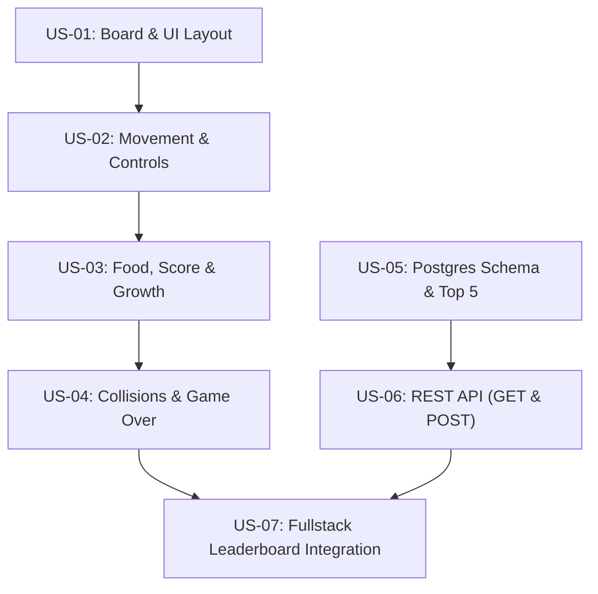

# Snake Game (Juego de la Culebrita) - User Stories Index

This directory contains the complete set of User Stories for the **Snake Game** with a web interface, PostgreSQL Top-5 persistence, and REST API. All stories have been enriched via `/enrich-us` with `## Original` and `## Enhanced` sections, complete technical specifications, file paths, Gherkin acceptance scenarios, non-functional requirements, and OpenSpec mandatory Definition of Done steps.

---

## 📋 User Stories Overview

| US ID | Title | Module | Status | Branch Name | File Link |
| :--- | :--- | :--- | :--- | :--- | :--- |
| **US-01** | Game Board Layout, Controls & Game State Shell | Frontend / UI | Enriched — Ready for `/opsx-ff` | `feature/US-01-game-board-layout` | [US-01-game-board-and-ui-layout.md](./US-01-game-board-and-ui-layout.md) |
| **US-02** | Snake Initial State, Auto-Movement & Arrow Controls | Frontend / Game Engine | Enriched — Ready for `/opsx-ff` | `feature/US-02-snake-movement-and-controls` | [US-02-snake-movement-and-controls.md](./US-02-snake-movement-and-controls.md) |
| **US-03** | Random Apple Spawning, Eating (+100 Pts) & Growth | Frontend / Mechanics | Enriched — Ready for `/opsx-ff` | `feature/US-03-food-scoring-and-growth` | [US-03-food-generation-scoring-and-growth.md](./US-03-food-generation-scoring-and-growth.md) |
| **US-04** | Collision Detection (Walls & Self) & Game Over | Frontend / Engine | Enriched — Ready for `/opsx-ff` | `feature/US-04-collision-and-game-over` | [US-04-collision-detection-and-game-over.md](./US-04-collision-detection-and-game-over.md) |
| **US-05** | PostgreSQL Schema, Domain Entity & Atomic Top-5 Repository | Backend / Database (DDD) | Enriched — Ready for `/opsx-ff` | `feature/US-05-database-top5-persistence` | [US-05-database-schema-and-persistence-setup.md](./US-05-database-schema-and-persistence-setup.md) |
| **US-06** | Leaderboard REST API (`GET` & `POST` `/api/scores`) | Backend / API (DDD) | Enriched — Ready for `/opsx-ff` | `feature/US-06-leaderboard-backend-api` | [US-06-leaderboard-backend-api.md](./US-06-leaderboard-backend-api.md) |
| **US-07** | Full-Stack Leaderboard Integration & Score Submission Flow | Fullstack / Integration | Enriched — Ready for `/opsx-ff` | `feature/US-07-leaderboard-frontend-integration` | [US-07-leaderboard-frontend-integration.md](./US-07-leaderboard-frontend-integration.md) |

---

## 🎯 Specification Traceability Matrix

| Requirement from Prompt | Addressed in Stories |
| :--- | :--- |
| **Web browser-based game** | US-01, US-02, US-03, US-04, US-07 |
| **Snake starts 30px × 30px, color green (`#22c55e`)** | US-01, US-02 |
| **Continuous automatic movement in last indicated direction (`150ms` tick)** | US-02 |
| **Controlled with keyboard arrow keys (with single-tick 180° reversal lock)** | US-02 |
| **Apple is red (`#ef4444`), 30px × 30px, in a 150px × 150px (5×5) grid board** | US-01, US-03 |
| **Apples appear randomly in game area without overlapping snake ($O(N)$ free-cell pool)** | US-03 |
| **100 points per apple eaten (`POINTS_PER_APPLE = 100`)** | US-03 |
| **Snake grows by 1 segment (30px × 30px) each time an apple is eaten** | US-03 |
| **Start button & Reset button (with focus blur handling)** | US-01, US-04 |
| **Game over when hitting walls or colliding with itself (with tail-vacating rule)** | US-04 |
| **PostgreSQL database keeping strictly Top 5 scores (atomic Serializable transaction)** | US-05 |
| **REST API to save & retrieve Top 5 scores (`GET /api/scores`, `POST /api/scores`)** | US-06 |
| **Integrated Leaderboard UI & Game Over submission modal** | US-01, US-07 |

---

## 🚀 Recommended Implementation Sequence

