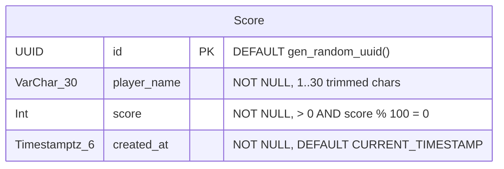

# Data Model Documentation

This document describes the database schema, domain entities, validation invariants, and Entity-Relationship (ER) diagram for the **Snake Game (Juego de la Culebrita)** application, persisted in PostgreSQL via Prisma ORM.

---

## 1. Domain & Persistence Model: `Score` (`scores` table)

The `Score` entity represents a qualifying player score in the **Top 5 Leaderboard**. The database enforces a strict maximum capacity of **5 records** (`MAX_LEADERBOARD_SIZE = 5`) at all times.

### Fields

| Field (Domain) | Column (`scores`) | PostgreSQL Type | Constraints & Defaults | Description |
| :--- | :--- | :--- | :--- | :--- |
| `id` | `id` | `UUID` | `PRIMARY KEY DEFAULT gen_random_uuid()` | Unique identifier for the score record |
| `playerName` | `player_name` | `VARCHAR(30)` | `NOT NULL`, `CHECK (char_length(btrim(player_name)) BETWEEN 1 AND 30)` | Trimmed player display name (`1..30` characters) |
| `score` | `score` | `INTEGER` | `NOT NULL`, `CHECK (score > 0 AND score % 100 = 0)` | Final game score (`>= 100`, multiple of `100`) |
| `createdAt` | `created_at` | `TIMESTAMPTZ(6)` | `NOT NULL DEFAULT CURRENT_TIMESTAMP` | Timestamp when the score was achieved |

### Indexes

- **`idx_scores_leaderboard`**: Composite B-Tree index on `(score DESC, created_at ASC, id ASC)` optimizing Top-5 leaderboard queries and tie-breaking.

---

## 2. Domain Validation Rules & Ranking Invariants

1. **Player Name (`playerName`)**:
   - Required string; leading and trailing whitespace is trimmed on instantiation.
   - Must be between `1` and `30` characters after trimming (`MIN_PLAYER_NAME_LENGTH = 1`, `MAX_PLAYER_NAME_LENGTH = 30`).
2. **Score Value (`score`)**:
   - Required positive integer strictly divisible by `100` (`score >= 100` and `score % 100 === 0`).
   - Violations throw a `DomainValidationError` (`code: 'DOMAIN_VALIDATION_ERROR'`) before touching the database.
3. **Deterministic Ordering & Tie-Breaking**:
   - Primary sort: `score DESC` (highest score ranked first).
   - Secondary sort: `createdAt ASC` (earlier achievement wins ties; a later identical score does not displace an earlier 5th-place score).
   - Tertiary sort: `id ASC` (deterministic final tie-breaker).
4. **Atomic Top-5 Retention (`saveIfTopFive`)**:
   - Executed inside a `Serializable` transaction (`Prisma.TransactionIsolationLevel.Serializable`):
     - If fewer than 5 records exist, the new score is inserted.
     - If 5 records exist and `newScore > fifthPlace.score`, the new score is inserted and all records beyond rank 5 (`allRecords.slice(5)`) are deleted in the same transaction.
     - If 5 records exist and `newScore <= fifthPlace.score`, no insert or delete is performed (`saved: false, rank: null`).

---

## 3. Entity Relationship Diagram

